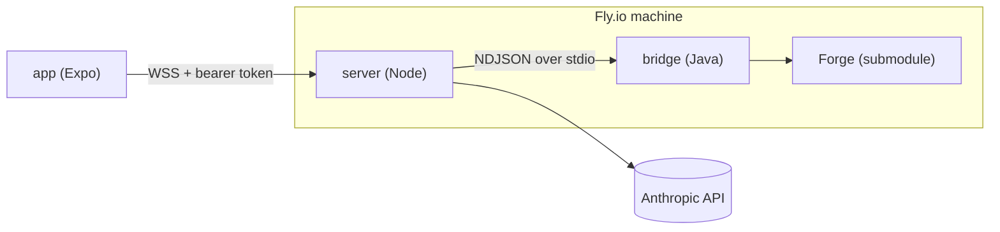

# Architecture

This file is the authority on MagicSim's stack and boundaries. The full design is in [`docs/superpowers/specs/2026-10-13-magicsim-design.md`](docs/superpowers/specs/2026-10-13-magicsim-design.md).

## Stack

| Part | Tech | Package manager / build |
|---|---|---|
| Rules engine | Forge (Java 17), git submodule at `forge/`, pinned SHA, never edited | Maven (pinned 3.9.11 in `.tools/`, installed by `scripts/setup.sh`) |
| `bridge/` | Java 17, depends on `forge:forge-gui` (+ transitive `forge-core`, `forge-game`, `forge-ai`) | Maven |
| `server/` | Node 24, TypeScript (strict), `node:http` + `ws`, `@anthropic-ai/sdk`, zod | pnpm |
| `packages/protocol/` | TypeScript + zod; source of truth for every message shape | pnpm |
| `app/` | Expo SDK 58 (React Native 0.88), TypeScript (strict), expo-router, expo-image, expo-secure-store, expo-linear-gradient | pnpm |
| Hosting | One Docker image on Fly.io (4 GB, auto-stop) | `infra/` |
| iOS builds | EAS Build (image `macos-tahoe-26.6-xcode-27.1`) → TestFlight; EAS Simulator for cloud iOS verification | `app/eas.json` |

Merge target: `main`. License: GPL-3.0 (required by Forge).

## Shape



## One decision, end to end

```mermaid
sequenceDiagram
  participant F as Forge game thread
  participant B as bridge (JsonRemote)
  participant S as server
  participant C as seat client (app or Claude harness)
  F->>B: ProtocolGuiGame → GuiGameEvent(method, args) via IRemote.sendAndWait
  B->>B: map to typed decision (+ legal options at priority)
  B->>S: {"type":"decision", ...}
  S->>C: decision (WS for human, tool-use turn for Claude)
  C->>S: action {decisionId, choice}
  S->>B: {"type":"action", ...}
  B->>F: reply to sendAndWait, or IGameController call (selectCard / selectButtonOk / selectAbility …)
  F-->>B: Forge re-validates; illegal → error + decision re-sent
```

## The Forge seam

- `forge.gamemodes.net.ProtocolGuiGame` implements every `IGuiGame` method by turning it into a `GuiGameEvent(ProtocolMethod, args)` and handing it to an `IRemote` (`send` / `sendAndWait`). Its own docs note an embedding host can consume these in-process.
- The bridge supplies **one `IRemote` implementation (`JsonRemote`)** and passes `new ProtocolGuiGame(jsonRemote)` as each human/Claude seat's GUI through `HostedMatch.startMatch(rules, variants, players, guisByPlayer, null)`.
- Client-to-server actions are calls on that seat's `PlayerControllerHuman`, which implements `forge.interfaces.IGameController`.
- Headless boot: `GuiBase.setInterface(new HeadlessGuiBase(forgeGuiDir))` (adapted from `forge-gui/tools/java/ForgeMatrixWriter.java`), then `FModel.initialize(null, null)`. Deterministic games: `MyRandom.setRandom(new Random(seed))`.
- Built-in decks: Forge's 180 official Commander precons in `forge/forge-gui/res/quest/commanderprecons/*.dck`.

## Boundaries

- **Legality lives only in Forge.** No other component decides what is legal; they render or choose among options the bridge sent.
- **Message shapes live only in `packages/protocol`.** Java records mirror them; a contract test validates bridge fixtures against the zod schemas.
- **Hidden information** is filtered by Forge's per-player views before serialization. The bridge never serializes another player's hidden cards.
- **Secrets** live in env (`.env` locally, Fly secrets in production) and the iOS Keychain (server URL + token only). Never in the repo.
- **Card images** load at runtime from Scryfall's CDN. Never committed.

## Forge patches

None. If one becomes unavoidable: fork to `tanner-pham/forge`, repoint the submodule, and list each patch here with the reason.

## Known limits (intentional)

- One game at a time; game state is in memory, so a server restart ends the game.
- Half-folded iPhone Duo layouts are not handled.
- Forge AI can think for minutes on crowded boards and ignores interrupts; automated games always run with a turn limit.
