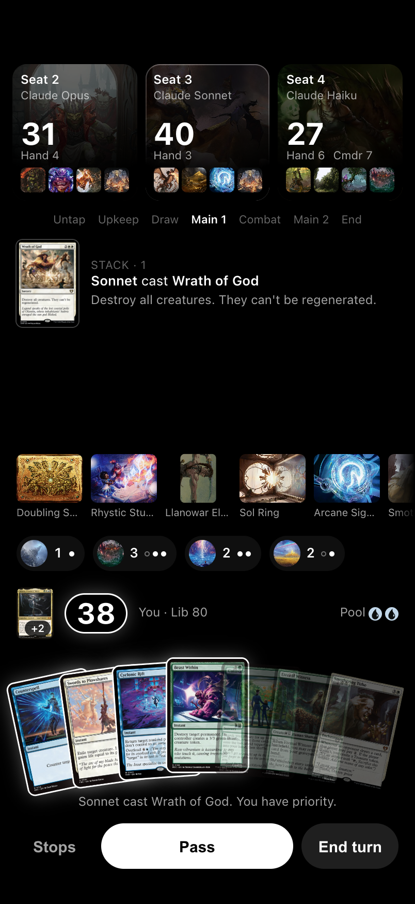

# MagicSim

A personal iPhone app for playing 4-player Commander against three opponents controlled by Claude models (or Forge's built-in AI). Rules, legality and the game engine come from [Forge](https://github.com/Card-Forge/forge), so every option the app offers is legal. Decks are imported from plain-text lists.



Status: planning is done, implementation has not started. See [`docs/STATUS.md`](docs/STATUS.md).

## How it fits together

```
iPhone app (Expo / React Native)
   │  HTTPS + WebSocket, bearer token
server (Node 24, TypeScript)  ──  Claude seats (Anthropic SDK, tool calls)
   │  NDJSON over stdio
forge-bridge (Java)  ──  Forge (pinned submodule, unmodified)
```

Details: [`ARCHITECTURE.md`](ARCHITECTURE.md). Design: [spec](docs/superpowers/specs/2026-10-13-magicsim-design.md), [mockup](docs/design/mockups/board.html), [screenshots](docs/design/screenshots/). Plans: [roadmap](docs/superpowers/plans/2026-10-13-magicsim-roadmap.md), [M0/M1](docs/superpowers/plans/2026-10-13-m0-m1-foundation-and-forge-spike.md).

## Quick start

Needs Java 17+ (Temurin 21 recommended) and Node 24.

```bash
git clone --recurse-submodules https://github.com/tanner-pham/MagicSim.git
cd MagicSim
bash scripts/setup.sh    # Maven into .tools/, Forge into the local Maven repo, JS deps
bash scripts/verify.sh   # runs every verification step that exists so far
cp .env.example .env     # then fill in keys for the server
```

Agents working in this repo start with [`AGENTS.md`](AGENTS.md).

## License and notices

GPL-3.0, because MagicSim builds on Forge (GPL-3.0). See [`LICENSE`](LICENSE).

MagicSim is unofficial Fan Content permitted under the Wizards of the Coast Fan Content Policy. Not approved or endorsed by Wizards. Portions of the materials used are property of Wizards of the Coast. ©Wizards of the Coast LLC. Card images are loaded at runtime from [Scryfall](https://scryfall.com) and are never stored in this repository. For personal, non-commercial use.
