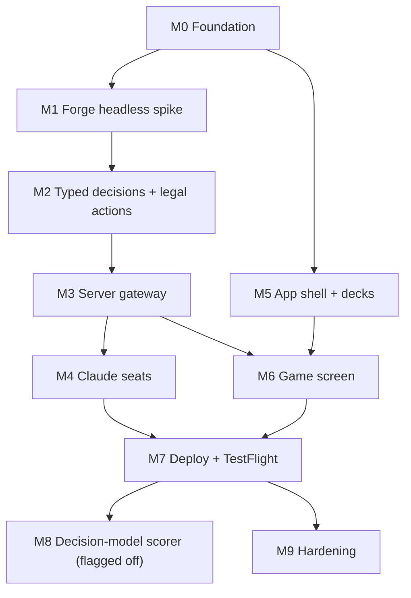

# MagicSim Roadmap

> **For agentic workers:** This is the milestone map. Each milestone gets its own detailed, bite-sized plan written with superpowers:writing-plans **at the start of that milestone**, grounded in the code as it exists then (only M0–M1 are detailed up front, because later steps depend on what the Forge spike reveals). Execute detailed plans with superpowers:subagent-driven-development.

**Goal:** Play 4-player Commander on iPhone / iPhone Duo against three Claude-controlled (or Forge AI) opponents, with Forge deciding all legality.

**Spec:** [`docs/superpowers/specs/2026-10-13-magicsim-design.md`](../specs/2026-10-13-magicsim-design.md) · **Visual spec:** `docs/design/`

## Dependency graph

M5 can run in parallel with M1–M4: it only needs `packages/protocol` and fixture observations.

## Milestones and gates

Every gate is evidence produced in that session (command output, pass counts, screenshots). A milestone is not done until its gate passes and `docs/STATUS.md` is updated.

### M0 Foundation
- pnpm workspace (`server`, `app`, `packages/protocol`), strict TS, ESLint, vitest.
- `bridge/` Maven project compiling against Forge; JUnit runs.
- `scripts/setup.sh` and `scripts/verify.sh` work on Linux and macOS; CI runs both.
- **Gate:** `bash scripts/setup.sh && bash scripts/verify.sh` green locally and in GitHub Actions.

### M1 Forge headless spike (highest risk; do before anything depends on it)
- Boot Forge headless (`HeadlessGuiBase`, `FModel.initialize`).
- Start a seeded 4-player Commander game from 4 precon `.dck` files, all Forge AI, play to completion, stream NDJSON `event`s and `gameOver` on stdout.
- Seat 1 as a human through `ProtocolGuiGame` + `JsonRemote`: every `GuiGameEvent` emitted as a raw JSON message; a scripted test client answers (pass priority, OK, first valid choice) and the game completes.
- **Gate:** JUnit test runs a seeded 4-player game with one scripted human seat to `gameOver` (turn-capped) in under 5 minutes; a second test proves the same seed gives the same event stream. (Both were already proven in a throwaway spike; see the M0/M1 plan header.)

### M2 Typed decisions + legal actions
- Map every decision kind in spec §4.3; generic `unmapped` fallback.
- Priority enumeration (spec §4.4) cross-checked against `AvailableActions.collectActionable`.
- Observations (spec §4.5) with per-player redaction; `packages/protocol` zod schemas; Java records; contract test.
- `GameState` scenario tests (at minimum: Counterspell vs Wrath of God; combat with first strike + trample damage assignment; London mulligan; commander tax recast; commander damage 21 loss; triggered-ability ordering).
- Forge AI slowness (spec §10): investigate a per-decision deadline for Forge-AI seats without editing Forge. Forge AI ignores interrupts and may touch game state while thinking, so a timed-out decision cannot simply be abandoned; if no safe approach exists, record the limit in `ARCHITECTURE.md` and emit a "Waiting for Forge AI" event so the app can show it.
- **Gate:** 10 seeded games (4 precons, 3 "random legal choice" scripted seats + 1 Forge AI) reach `gameOver` with 0 `unmapped`; all scenario tests pass; contract test passes.

### M3 Server gateway
- `node:http` + `ws`; bearer-token auth (constant-time); spawns bridge; one active game; routes per spec §8; `GET /decks/precons`; `POST /decks/parse` via Forge `DeckRecognizer`; reconnect + resync.
- **Gate:** vitest suite green; scripted WS client plays a full game against 3 Forge AI seats through the server; reconnect mid-game resumes with the pending decision.

### M4 Claude seats
- Harness per spec §6 with tools `get_board`, `inspect_card`, `get_history`, `choose`; prompt caching; compaction; limits; Forge AI fallback; token budget; JSONL transcripts.
- **Gate:** fake-model tests green (including an always-erroring model whose seat still finishes the game); with `ANTHROPIC_API_KEY`, one real 4-player game (3 Claude seats on the cheapest listed model + 1 scripted seat) completes, with total tokens and cost recorded in `docs/STATUS.md`. Without the key: BLOCKED for the real-model half only.

### M5 App shell + decks
- Expo SDK 58 app (expo-router); design tokens from the mockup; Settings (server URL + token in secure store); Decks list/import/detail (paste + file picker → server parse); New game (your deck, 3 opponents each with deck from saved or precons + controller).
- **Gate:** unit tests + typecheck; Playwright screenshots of the web build at 402×874, 466×678, 626×890 for every screen, no clipping or overflow.

### M6 Game screen
- Board per the mockups: opponent tiles + opponent board sheet, stack, phase rail, battlefield tiles, land chips, hand with legal outlines, card action sheet, game-action bar, stops, zone viewers, card detail, log (sheet on compact, sidebar on regular), game-over.
- **Gate:** Playwright drives a complete game on the web build (human seat vs 3 Forge AI) using only on-screen actions; screenshots at the 3 viewports compared against `docs/design/screenshots/`; differences listed and justified.

### M7 Deploy + TestFlight
- `infra/Dockerfile` (multi-stage: Forge+bridge jar, server, Forge `res/`), `infra/fly.toml` (4 GB, auto-stop), `fly deploy`; `app/eas.json` profiles (simulator, production on image `macos-tahoe-26.6-xcode-27.1`); EAS Simulator verification (iPhone Duo device if listed); `eas submit` to TestFlight.
- **Gate:** EAS Simulator screenshots of a real game against the Fly server; TestFlight build processed. Requires `FLY_API_TOKEN`, `EXPO_TOKEN`, App Store Connect API key, and deploy/submit grants.

### M8 Decision-model scorer (disabled by default)
- `DECISION_SCORER=off|subq|openai`; `propose` tool; scorer adapters for SubQ `POST /v1/systemone` and OpenAI `POST /v1/decisions` (`gpt-6-luna`).
- **Gate:** unit tests with recorded responses; one real game with the scorer on if a key exists.

### M9 Hardening
- Image caching and prefetch, long-game performance, error/empty states, accessibility labels on every control, Forge upgrade procedure tested once.
- **Gate:** a 20-turn game on EAS Simulator with no dropped frames reported by the React Native perf monitor above the agreed threshold, and no unhandled errors in server logs.

## Reference decks

Use Forge's bundled precons for all automated games, so no decklists need authoring:
`forge/forge-gui/res/quest/commanderprecons/` — e.g. `Arcane Wizardry [C17] [2017].dck`, `Breed Lethality [C16] [2016].dck`, `Adaptive Enchantment [C18] [2018].dck`, `Counter Blitz [FIC] [2025].dck`. All four were verified on 2026-10-13: each is exactly 100 cards and loads through `DeckSerializer` in the headless spike. Counter Blitz (Tidus) produces crowded token boards where Forge AI can think for minutes, which is why every game takes a turn limit.
