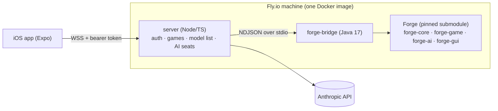

# MagicSim — Design Spec

Date: 2026-10-13 · Status: approved in brainstorming, pending written-spec review

## 1. Goal

A personal iOS app for playing 4-player Commander: you against three opponents controlled by Claude models (or Forge's built-in AI). Import decks from common text formats, save them, and play a full game with real card art, where every option offered is legal under the Magic rules. The engine, the AI harness and the app are built around one idea: **a game is a sequence of decisions, each with an enumerated set of legal options, answered through tool-call-shaped actions against a per-player view of state and history.**

### In scope (v1)

- 4-player Commander (40 life, command zone, commander tax, 21 commander damage, color identity, singleton). One human seat, three AI seats.
- Every card Forge supports (Forge implements effectively the whole legal card pool).
- Deck import from text (Arena, MTGO, Moxfield/Archidekt plain text, `1x Name`), validation, on-device storage.
- AI seats driven by any Claude model from Anthropic's live model list; Forge AI as a free option and as fallback.
- iPhone (compact width) and iPhone Duo (outer display compact, inner display regular x regular). Built with the iOS 27.1 SDK.
- Personal deployment: one server on Fly.io, one app on TestFlight, one shared access token.

### Out of scope (v1)

- Accounts, multiple human players, matchmaking, App Store release, Android.
- Formats other than Commander (Forge supports them; we don't expose them).
- Resuming a game after a server restart.
- Half-folded iPhone Duo layouts (the fold reserved-region API is native-only; see §7.4).
- The decision-model scorer is designed (§6.5) but ships disabled and is built last.

## 2. Decisions

| Area | Decision | Why |
|---|---|---|
| Rules engine | Fork Forge (GPL-3.0) as a pinned git submodule, untouched; add our own `forge-bridge` module | Forge already implements the rules and ~30k cards. Reinventing that is the largest possible waste. |
| App | Expo SDK 58 (React Native 0.88), TypeScript | Builds, tests and renders on Linux cloud machines; EAS builds iOS in the cloud. SDK 58 is Expo's iOS 27 line. |
| Hosting | One Docker image on Fly.io, auto-stop when idle | Play from anywhere; agents can deploy hands-off. |
| Distribution | EAS Build → TestFlight (Apple Developer Program) | No Mac in the loop. |
| AI seats | Claude only in v1 (tool use); Forge AI fallback | Simple and consistent. Decision-model scoring is a later, flagged add-on. |
| License | GPL-3.0 for the whole repo | Required by linking Forge; simplest to apply repo-wide. |

## 3. Architecture



### 3.1 Repo layout

```
MagicSim/
  forge/                 git submodule → github.com/Card-Forge/forge @ pinned SHA (never edited)
  bridge/                Maven project: forge-bridge (Java 17), depends on Forge modules
  server/                Node 24 + TS: HTTP/WS gateway, game manager, AI seat harness
  app/                   Expo SDK 58 app
  packages/protocol/     zod schemas + inferred TS types, shared by server and app
  infra/                 Dockerfile, fly.toml
  scripts/               setup.sh, verify.sh, dev helpers
  docs/                  specs, plans, design mockups + screenshots
  .cursor/environment.json, .github/workflows/
  AGENTS.md, ARCHITECTURE.md, README.md, LICENSE (GPL-3.0)
```

pnpm workspace covers `server`, `app`, `packages/*`. Maven covers `bridge`.

**Forge policy:** the submodule is never edited. If a Forge change is truly unavoidable, fork to `tanner-pham/forge`, repoint the submodule, and record the patch and reason in `ARCHITECTURE.md`. Upgrading Forge (new sets) = bump the SHA and run `scripts/verify.sh`.

### 3.2 Processes

- **server** is the only public endpoint. It authenticates the app, owns the single active game, spawns the bridge as a child process, runs AI seats, and serves the Claude model list.
- **forge-bridge** runs Forge in-process with no GUI. It plays the role that Forge's `RemoteClientGuiGame` plays for network games, but speaks JSON. It converts every Forge prompt into a typed `decision` with enumerated options and applies `action`s back through Forge's own controller API.
- **Forge** decides all legality. The bridge never re-implements a rule.

## 4. forge-bridge (Java)

### 4.1 Bootstrapping Forge headless

Reference implementations inside Forge to study first:
- `forge-gui-desktop/src/main/java/forge/view/SimulateMatch.java` — starts matches with no GUI (`sim` mode).
- `forge-gui/src/main/java/forge/gamemodes/net/server/RemoteClientGuiGame.java` — server-side `IGuiGame` for a remote human; our `JsonGuiGame` mirrors it.
- `forge-gui/src/main/java/forge/gamemodes/net/ProtocolMethod.java` — the full list of ~45 server→client and ~16 client→server calls a remote seat must handle.
- Forge's network test harness (headless AI clients over TCP; see Forge wiki "Network Testing").
- `forge-ai/src/main/java/forge/ai/AvailableActions.java` — computes which cards are playable this priority window.
- `forge-core/src/main/java/forge/deck/DeckRecognizer.java` — parses pasted decklists.
- `forge.ai.GameState` — loads a described board state; used for scenario tests.

The bridge provides a headless `IGuiBase` whose assets directory is `forge/forge-gui/res` (in Docker: a copied `res/`), loads card data once at startup, then waits for commands.

### 4.2 Seats

- **Human seat and Claude seats** use Forge's `PlayerControllerHuman` with our `JsonGuiGame` as their GUI. A Claude seat is literally a remote client of the same protocol as the phone.
- **Forge AI seats** use `PlayerControllerAi` and emit no decisions (only observations/events for the log).

### 4.3 Turning Forge prompts into decisions

Forge's human interaction is Input-driven (`InputPassPriority`, `InputSelectTargets`, `InputAttack`, `InputBlock`, `InputPayMana`, `InputConfirmMulligan`, `InputSelectCardsFromList`, …) plus direct `IGuiGame` calls (`getChoices`, `confirm`, `order`, `assignCombatDamage`, …). Because the bridge is in-process, it inspects the active Input / called method directly and emits a typed decision instead of reverse-engineering prompt text.

| Decision kind | Forge source |
|---|---|
| `priority` | `InputPassPriority` |
| `targets` | `InputSelectTargets`, `chooseSingleEntityForEffect`, `chooseEntitiesForEffect` |
| `chooseCards` | `InputSelectCardsFromList`, `getChoices`, `manipulateCardList` |
| `confirm` | `confirm`, `showConfirmDialog` |
| `option` | `showOptionDialog`, `getChoices` over strings |
| `number` | `getChoices` over integers, `showInputDialog` |
| `order` | `order` |
| `assignDamage` | `assignCombatDamage`, `assignGenericAmount` |
| `attackers` / `blockers` | `InputAttack` / `InputBlock` |
| `manaPayment` | `InputPayMana` (option `auto` first; manual picks list mana sources) |
| `mulligan` | `InputConfirmMulligan` and London-mulligan bottoming |

Blocking calls (e.g. `getChoices` returning a value) block the game thread on a future until the matching `action` arrives, the same pattern as Forge's `ReplyPool`.

Any Forge prompt the bridge does not recognize becomes a generic `chooseCards`/`option` decision built from the raw choices, logged as `unmapped` so it can be mapped properly later. The game never stalls on an unknown prompt.

### 4.4 Legal-action enumeration at priority

At every `priority` decision, the bridge builds the full option list:
- For each card the player can act with (hand, battlefield, command zone, and graveyard/exile cards with castable abilities such as flashback): `card.getAllPossibleAbilities(player, true)` filtered by Forge's `canPlay` checks. Each ability becomes one option: `{ id, kind: "cast"|"activate"|"playLand"|"special", cardId, label, cost }`. Mana abilities are excluded here and appear in `manaPayment`.
- Game actions: `pass` (pass priority) and `passUntilEndOfTurn` (Forge auto-yield). The app's "End turn" maps to the latter, bounded by the player's stops.
- Cross-check: every card in `AvailableActions.collectActionable` must have at least one option or a logged discrepancy.

Selecting an option drives the same path a click would (`selectCard` + chosen ability / `selectAbility`). Targets, modes, X and costs then arrive as follow-up decisions. Forge re-validates everything; a stale action is rejected with an error and the decision is re-sent.

**Auto-pass:** if a priority decision's only option is `pass`, the bridge answers it without emitting a decision (logged). The human's stops settings (§7.3) decide which other priority windows auto-pass when the stack is empty.

### 4.5 Observations

Built from Forge's per-player `GameView`/`CardView` visibility, so redaction is Forge's, not ours:
- Turn number, active player, phase/step, priority holder, monarch/initiative if present.
- Per player: life, poison, commander damage received (per commander), counters, mana pool, hand count, library count, revealed hand cards, commander(s) and tax.
- Zones: battlefield (tapped, counters, attachments, P/T, summoning sickness, controller/owner), stack (source, controller, text, targets), graveyards, exile (face-up), command zone.
- Own hand in full. Hidden cards from other players are never serialized.
- Each card carries `setCode` + `collectorNumber` (and `name`) for image lookup.

### 4.6 Bridge ↔ server transport

Newline-delimited JSON over stdio. stdout is reserved for protocol messages; all Forge and bridge logging goes to stderr. Commands from server: `startGame`, `action`, `concede`, `resync`, `parseDeck`, `shutdown`. Messages to server: `ready`, `observation`, `decision`, `event`, `error`, `gameOver`, `deckParsed`.

## 5. Protocol (`packages/protocol`)

zod schemas are the single source of truth for TS. The Java side uses hand-written records; a contract test validates bridge output fixtures against the zod schemas in CI.

- `observation { seat, version, state }` — §4.5.
- `decision { id, seat, kind, prompt, options: Option[], min, max, defaultOptionId? }`.
- `action { decisionId, choice: string[] | number | Record<string, number> }`.
- `event { seq, turn, kind, text, data }` — structured log entry plus one plain sentence ("Sonnet cast Wrath of God."). This is the game history.
- `protocolVersion` integer; the server rejects mismatched clients with a readable error.

## 6. AI harness (`server/src/seats`)

### 6.1 Seat configuration

`{ seat, controller: "claude" | "forge-ai", model?: string, deck }`. The model list comes from Anthropic's models endpoint at runtime (cached 1 hour); nothing is hardcoded.

### 6.2 Conversation shape

One Messages-API conversation per seat per game (`@anthropic-ai/sdk`).
- **System prompt (cached):** Commander rules primer, the seat's own decklist and commander, how the tools work, "you only ever choose among the listed options".
- **Per decision:** one user message containing events since this seat's last decision, a compact observation, and the decision with its options.
- **Compaction:** every 3 turns, older turn transcripts are replaced by a summary turn the harness asks the model to write.

### 6.3 Tools

| Tool | Returns |
|---|---|
| `get_board()` | the seat's full current observation |
| `inspect_card(cardId)` | oracle text, counters, attachments, controller, owner |
| `get_history(sinceTurn)` | event log entries |
| `choose(optionIds \| amount \| assignment)` | submits the `action`; the only state-changing tool |

### 6.4 Limits and fallback

- Max 6 tool calls and 60 s per decision (configurable).
- Invalid `choose` → tool error with the reason; after 2 failed attempts, or on timeout/API error, the decision falls back to Forge AI. Requirement: **a seat whose model always errors still completes a game.** Implementation candidates, in order: (a) answer that one decision with the equivalent `PlayerControllerAi` method for the same player; (b) temporarily swap the player's controller to `PlayerControllerAi` until the next priority decision. The implementer picks whichever Forge supports cleanly and documents it.
- Per-game token budget per seat (`AI_TOKEN_BUDGET`); when exhausted the seat switches to Forge AI for the rest of the game and the log says so.
- Every model request/response (minus keys) is written to a per-game JSONL transcript for debugging.

### 6.5 Decision-model scorer (later milestone, disabled by default)

`DECISION_SCORER=off|subq|openai`. When enabled for a seat, Claude calls `propose(optionIds[2..4])` instead of `choose`; the harness asks the decision model (SubQ Snap via `POST /v1/systemone`, or OpenAI `POST /v1/decisions` with `gpt-6-luna`) to score each candidate against a short rubric, and submits the highest-scoring option. It only ever ranks options the bridge already declared legal.

## 7. App (`app/`)

### 7.1 Screens

- **Settings:** server URL, access token (Keychain via `expo-secure-store`), default opponent models, stops.
- **Decks:** list (commander art, name, color identity, card count, validity). Import by pasting text or picking a `.txt`/`.dek` file; the server parses with Forge's recognizer and returns resolved cards plus problems (unrecognized names, not singleton, color identity, deck size). Deck detail groups cards by type with images. Decks are stored on device as JSON files (`expo-file-system`); export copies the text back out.
- **New game:** pick your deck; for each of 3 opponents pick a deck (one of your saved decks or one of Forge's 180 bundled Commander precons) and a controller (a Claude model or Forge AI); start.
- **Game:** per the approved mockups. Opponent tiles open that player's full board in a sheet; zone viewers for graveyard/exile/revealed cards; long-press any card for full card and oracle text; log sheet on phone, sidebar on regular width; game-over summary.

### 7.2 Visual spec

The approved mockup is the spec: `docs/design/mockups/board.html` and `docs/design/screenshots/` (phone board, card action sheet, Duo inner board). Design tokens come from the mockup's `:root` block.

- Black background, white text, secondary text at 64%/40% white. No borders or dividers; separation comes from spacing and fades.
- Scrolling rows and overlays fade into black at their edges (`expo-linear-gradient`). The card action sheet raises over a board that recedes into black; no hard panel edge.
- Hand: legal plays get a white outline, everything else is dimmed to ~38%. Driven by the priority decision's options.
- Battlefield: art-crop tiles with names; tapped rotates. Lands collapse to one chip per name with tapped/untapped dots. Commander shows tax.
- Bottom bar: game actions (Stops, Pass, End turn). Card sheet: that card's legal options, the most likely one as the white primary row.
- Copy follows the writing-ui rules: plain and factual. An AI seat waiting shows "Waiting for Sonnet", never "Thinking…".

### 7.3 Stops

Per-step toggles (like Arena) stored on device and sent at game start. Defaults: stop in your main phases, combat declare steps, and whenever something is on the stack you could respond to.

### 7.4 Layout

- Width < 600 pt → compact layout (iPhone, Duo outer). Portrait only.
- Width ≥ 600 pt → regular layout (Duo inner 626×890): larger opponent panels, game log sidebar. Any orientation.
- Use window dimensions (size-class equivalent), never device idiom or orientation.
- `ponytail:` half-folded Duo is not handled; content may sit across the fold. Upgrade path: a small Expo native module exposing iOS 27.1 reserved regions (`reservedRegions(kind: .division)`).

### 7.5 Card images

`expo-image` with disk caching, loaded from Scryfall's image CDN by `setCode`/`collectorNumber` (fallback: exact name). Any Scryfall API calls go through the server with a proper `User-Agent` and caching. Card images are never committed to the repo.

## 8. Server (`server/`)

- `GET /health` · `GET /models` · `GET /decks/precons` · `POST /decks/parse` · `POST /games` · `GET /games/current` · `WS /games/current/stream`.
- `GET /decks/precons` lists Forge's bundled Commander precons (name, commander, colors) so opponents need no imported decks; `POST /games` accepts either a saved decklist or a precon name per seat.
- Auth: `Authorization: Bearer <MAGICSIM_TOKEN>` on every route except `/health`, compared in constant time. Request bodies validated with the protocol zod schemas.
- One active game. Starting a new game ends the current one after confirmation in the app.
- Reconnect: on WS connect, send the latest observation, the pending decision (if any), and events since the client's last `seq`.
- Secrets via env (`ANTHROPIC_API_KEY`, `MAGICSIM_TOKEN`, optional `SUBQ_API_KEY`, `OPENAI_API_KEY`); Fly secrets in production, `.env` locally (gitignored, `.env.example` committed).
- `ponytail:` game state lives in memory; a machine restart ends the game. Upgrade path: persist the event log and replay through Forge's `GameState`.

## 9. Dev environment and verification

Everything except the iOS build itself runs on a Linux machine, so any cloud agent can work without a Mac.

### 9.1 Toolchain

JDK 17+ (Temurin 21 is fine; Forge targets release 17), Maven 3.9, Node 24, pnpm, Chromium for Playwright, EAS CLI, flyctl. `scripts/setup.sh` is idempotent: inits the submodule shallowly, installs Forge modules to the local Maven repo (`-pl forge-gui -am -DskipTests`), builds the bridge, installs JS deps, installs Playwright Chromium.

`.cursor/environment.json` uses `scripts/setup.sh` as `install`. The same script backs `.devcontainer/` and CI so Claude Code, Codex and Cursor cloud sessions share one setup.

### 9.2 Verification ladder (`scripts/verify.sh` runs 1–5)

1. **Bridge unit + scenario tests** (JUnit): `GameState`-based scenarios, e.g. "opponent casts Wrath of God, human holds Counterspell with UU available → priority options include Cast Counterspell targeting Wrath of God; choosing it counters the spell."
2. **Protocol contract tests:** bridge fixtures validate against zod schemas.
3. **Server tests** (vitest): auth, reconnect/resync, seat harness against a fake model (scripted tool calls), fallback when the model always errors.
4. **Full headless game:** server + real bridge, three seats on a fake model plus one scripted "human" client, 4-player Commander game reaches `gameOver` with zero `unmapped` decisions on the reference decks.
5. **App:** typecheck, lint, unit tests, then Expo web export + Playwright screenshots at 402×874, 466×678 and 626×890 against a running server, compared visually against the mockups.
6. **Real iOS (cloud, needs `EXPO_TOKEN`):** EAS Build simulator profile on image `macos-tahoe-26.6-xcode-27.1`; EAS Simulator session (`eas simulator:start --platform ios --type agent-device`, choose the iPhone Duo device if listed, else the default iPhone) to tap through a game and capture screenshots. EAS Workflows can run Maestro flows for regression.
7. **Ship:** `eas build --profile production` + `eas submit` to TestFlight; `fly deploy` for the server.

### 9.3 One-time setup by Tanner

Secrets the autonomous run needs but cannot create: `ANTHROPIC_API_KEY`, `EXPO_TOKEN`, App Store Connect API key (for `eas submit`), `FLY_API_TOKEN`. Optional: `SUBQ_API_KEY`, `OPENAI_API_KEY`. Without them, work continues through rung 5 and the run reports exactly which rungs are blocked.

## 10. Risks

| Risk | Mitigation |
|---|---|
| Forge has no documented headless API; static singletons and asset paths assume a GUI | Follow `SimulateMatch` and the network test harness; spike this first (milestone 1) before anything else depends on it |
| Mapping every Forge prompt to a typed decision | Generic fallback decision + `unmapped` logging; reference-deck full games gate milestone completion |
| Forge upstream churn | Pinned SHA; upgrades are deliberate |
| Forge AI can think for minutes on crowded boards (seen in the spike) and ignores thread interrupts | Turn limits in all automated games; M2 investigates a safe per-decision deadline for Forge-AI seats (abandoning a decision mid-thought is unsafe because the AI may touch game state); at minimum the app shows "Waiting for Forge AI" so a long pause is visible |
| Forge memory (~1.5–2 GB heap with all cards) | Fly machine with 4 GB; auto-stop keeps cost down |
| Expo SDK 58 is beta | Pin it; move to stable when released |
| Model cost/latency per game | Auto-pass, stops, per-seat token budget, prompt caching |
| Card art and text are Wizards of the Coast IP | Unofficial fan content, personal non-commercial use; images loaded at runtime from Scryfall, never committed; notice in README |
